<picture>
  <source media="(prefers-color-scheme: dark)" srcset="https://github.com/rafeyshah/rafeyshah/raw/main/assets/header-dark.svg">
  <source media="(prefers-color-scheme: light)" srcset="https://github.com/rafeyshah/rafeyshah/raw/main/assets/header-light.svg">
  
</picture>

  
  
  

  Full-Stack Engineer at <b>LeanoSol</b> and MSc Data Science student at <b>FAU Erlangen-Nürnberg</b>. 
  I build web products that are tested, secure and deployed — and ML pipelines that are measured, not just trained.

 

## ⭐ Featured — GawainBook

**Reading circles without spoilers.** A full-stack TypeScript platform where small groups read the same book at their own pace — every discussion, reply, search result and notification stays locked until you reach that chapter.

  
  

<table>
  <tr>
    <td width="50%" valign="top">

**What it does**
- Public and invite-only **reading circles** with organiser & moderator roles
- **Spoiler-locked discussions** + a "who's where" progress view
- **Library** with shelves, chapter-by-chapter progress and Open Library search
- **Social feed** — photo posts, spoiler covers, comments, likes, follows
- **Safety** — reporting, blocking, admin moderation, rate limits

</td>
    <td width="50%" valign="top">

**How it's built**
- One central **access policy**, also enforced in SQL — locked content never leaves the database
- Session cookies (hashed tokens), **CSRF protection**, bcrypt, Helmet
- Private S3-compatible photo storage with **presigned URLs**
- **1,100+ automated tests** — 661 API, 468 UI, Playwright E2E journeys
- CI on GitHub Actions, auto-deploy to **Render**

</td>
  </tr>
</table>

  
  
  
  
  
  
  
  
  

<table>
  <tr>
    <td width="40%"></td>
    <td width="40%"></td>
    <td width="20%"></td>
  </tr>
  <tr>
    <td align="center">Reading circle · locked chapters</td>
    <td align="center">Chapter discussion</td>
    <td align="center">Mobile</td>
  </tr>
</table>

 

## 🔬 Research — GothiRead

**OCR & font recognition for historical Gothic scripts** · FAU Pattern Recognition Lab  
An end-to-end pipeline that transcribes multi-font historical documents *and* predicts the font group of every character — from dataset validation and grapheme-level normalisation to benchmarking, fine-tuning and ensembling.

| Task | Approach | Result |
|---|---|---|
| Text recognition | Fine-tuned PaddleOCR (benchmarked vs. TrOCR, Donut, PARSeq, ABINet) | **1.3% CER** · 8.0% WER |
| Font-group recognition | CRNN + Transformer (CTC) with risk-based ensemble | **2.1% font CER** on 17.9k lines |

  
  
  
  
  

 

## 🧩 More projects

| Project | Description | Stack |
|---|---|---|
| **[NASA-404](https://github.com/rafeyshah/NASA-404)** | Mission-control REST API with versioning, CSV ingestion, Node clustering and Jest/Supertest tests | Node.js · Express · MongoDB |
| **[VocareWebApp](https://github.com/rafeyshah/VocareWebApp)** | Calendar-based appointment management system | TypeScript · React |
| **[DineRank](https://github.com/rafeyshah/DineRank-RestaurantRating)** | Restaurant-rating prediction across 4 markets — EDA, feature engineering, model comparison | Python · pandas · scikit-learn |

 

## 🛠️ Toolbox

<table>
  <tr>
    <td align="center" width="25%"><b>Frontend</b>  </td>
    <td align="center" width="25%"><b>Backend</b>  </td>
    <td align="center" width="25%"><b>ML / Data</b>  </td>
    <td align="center" width="25%"><b>Testing & Ops</b>  </td>
  </tr>
</table>

 

## 👨‍💻 Experience

| | Role | Company |
|---|---|---|
| **Now** | Full-Stack Engineer | LeanoSol · Nuremberg |
| 2024 | Working Student — IT Support / SysAdmin | Refair IT · Nuremberg |
| 2023–24 | Software Engineer | Discretelogix · Islamabad |
| 2022 | Data Science Intern | IPRI · Islamabad |

🎯 **Open to:** Full-Stack / Software Engineering roles · Werkstudent (15–20 h/week) · Master's thesis in ML / Document AI  
🗣️ English (fluent) · German (learning, A2)

 

  

