<picture><source media="(prefers-color-scheme: dark)" srcset="assets/header-dark.svg"><source media="(prefers-color-scheme: light)" srcset="assets/header-light.svg"></picture>

  <a href="https://www.linkedin.com/in/YOUR-LINKEDIN/"><picture><source media="(prefers-color-scheme: dark)" srcset="assets/btn-linkedin-dark.svg"><source media="(prefers-color-scheme: light)" srcset="assets/btn-linkedin-light.svg"></picture></a>&nbsp;
  <a href="mailto:dev.abdulrafey@gmail.com"><picture><source media="(prefers-color-scheme: dark)" srcset="assets/btn-email-dark.svg"><source media="(prefers-color-scheme: light)" srcset="assets/btn-email-light.svg"></picture></a>

  I build full-stack products that are tested, secure and shipped — 
  and ML pipelines that are measured, not just trained.

 

## Featured project

### [GawainBook](https://github.com/rafeyshah/GawainBook-SocialMediaApp) — reading circles without spoilers

A full-stack TypeScript platform where small groups read the same book at their own pace. Every discussion, reply and notification stays locked until you reach that chapter — enforced in one access policy and again in SQL, so locked content never leaves the database.

<a href="https://gawainbook.onrender.com"><picture><source media="(prefers-color-scheme: dark)" srcset="assets/btn-demo-dark.svg"><source media="(prefers-color-scheme: light)" srcset="assets/btn-demo-light.svg"></picture></a>&nbsp;
<a href="https://github.com/rafeyshah/GawainBook-SocialMediaApp"><picture><source media="(prefers-color-scheme: dark)" srcset="assets/btn-source-dark.svg"><source media="(prefers-color-scheme: light)" srcset="assets/btn-source-light.svg"></picture></a>

<picture><source media="(prefers-color-scheme: dark)" srcset="assets/gawainbook-stats-dark.svg"><source media="(prefers-color-scheme: light)" srcset="assets/gawainbook-stats-light.svg"></picture>

Screenshots, features &amp; architecture

 

<table>
  <tr>
    <td width="40%"></td>
    <td width="40%"></td>
    <td width="20%"></td>
  </tr>
</table>

| What it does | How it's built |
|---|---|
| Public & invite-only reading circles with organiser and moderator roles | React 17 + Express on Node 22, TypeScript end to end |
| Spoiler-locked discussions and a "who's where" progress view | PostgreSQL on Neon via Drizzle ORM, committed SQL migrations |
| Library with shelves, chapter progress and Open Library search | httpOnly session cookies (SHA-256 hashed), double-submit CSRF, bcrypt, Helmet |
| Social feed — photo posts, spoiler covers, comments, likes, follows | Private S3-compatible photo storage with presigned URLs |
| Reporting, blocking, admin moderation and rate limits | Jest, Supertest, React Testing Library, Playwright · CI → Render |

 

## Research

### [GothiRead](https://github.com/rafeyshah/gothi-read) — OCR &amp; font recognition for historical Gothic scripts

Built at the FAU Pattern Recognition Lab: a pipeline that transcribes multi-font historical documents and predicts the font group of every character — from dataset validation and normalisation to benchmarking, fine-tuning and ensembling.

<picture><source media="(prefers-color-scheme: dark)" srcset="assets/gothiread-stats-dark.svg"><source media="(prefers-color-scheme: light)" srcset="assets/gothiread-stats-light.svg"></picture>

 

## More projects

| Project | Description | Stack |
|---|---|---|
| **[NASA-404](https://github.com/rafeyshah/NASA-404)** | Versioned REST API with CSV ingestion, Node clustering and Jest/Supertest tests | Node.js · Express · MongoDB |
| **[VocareWebApp](https://github.com/rafeyshah/VocareWebApp)** | Calendar-based appointment management system | TypeScript · React |
| **[DineRank](https://github.com/rafeyshah/DineRank-RestaurantRating)** | Restaurant-rating prediction across 4 markets — EDA, feature engineering, model comparison | Python · scikit-learn |

 

## Toolbox

<picture><source media="(prefers-color-scheme: dark)" srcset="assets/toolbox-dark.svg"><source media="(prefers-color-scheme: light)" srcset="assets/toolbox-light.svg"></picture>

 

## Experience

<picture><source media="(prefers-color-scheme: dark)" srcset="assets/experience-dark.svg"><source media="(prefers-color-scheme: light)" srcset="assets/experience-light.svg"></picture>

 

Open to full-stack roles, Werkstudent positions (15–20 h/week) and a Master's thesis in ML / Document AI · <a href="mailto:dev.abdulrafey@gmail.com">dev.abdulrafey@gmail.com</a>

